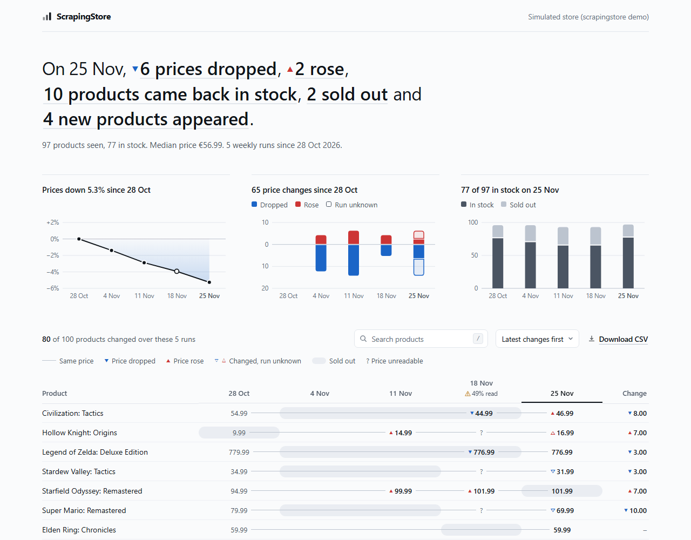
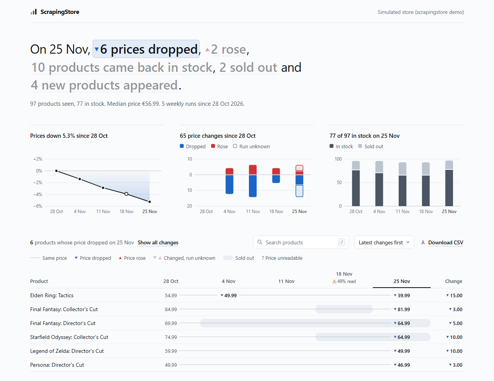
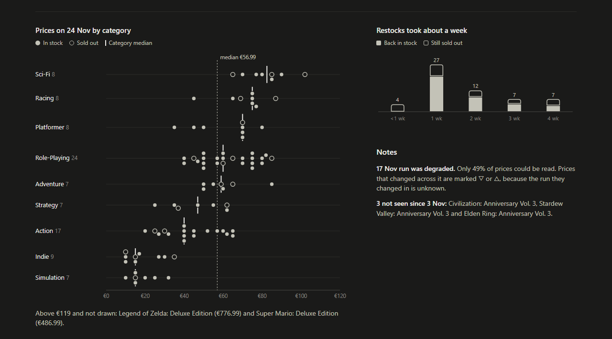
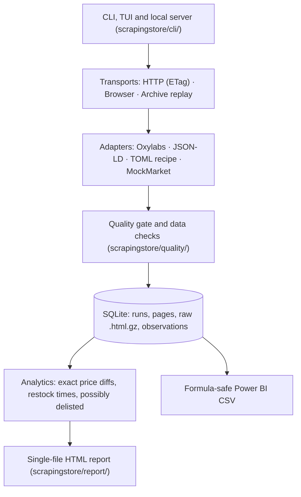

# ScrapingStore


**Collect product prices and stock from online stores, keep every run, and see what changed.**

ScrapingStore saves each collection as a separate run in SQLite, together with the raw HTML of every page. A price it can't read is stored as unknown, never as zero. A product that isn't seen in a run is reported as not seen, never as sold out. When a run reads far fewer prices than usual, it is marked `degraded` and isn't published unless you ask for it. You can `diff` two runs, `blame` a product's fields, and `reparse` old runs with a newer parser.

**[Demo report](https://tzii.github.io/ScrapingStore/)**: five weekly runs of a simulated store, built with `scrapingstore demo`.



<details>
<summary><strong>Each number in the summary filters the table</strong></summary>



</details>

<details>
<summary><strong>Prices by category, restock times and notes, dark theme</strong></summary>



</details>

---

## What it does

- **A one-page HTML report** that opens offline, with no external scripts, styles or fonts. The first sentence says what changed in the latest run, and each number in it filters the table. Under it, three charts show how much a typical price has moved since the first run, how many prices dropped or rose in each run, and how much was in stock. The table has one row per product and one column per run, showing price drops ▼, rises ▲, sold-out stretches and unreadable prices. Below it are current prices by category, a histogram of how long products stayed sold out, and notes on degraded runs and products that stopped appearing. Download CSV exports the rows you filtered.
- **Careful comparisons.** The summary only compares the last two runs, and only products with a stable ID, the same way `diff` does. If a price changed across a run that couldn't read it, the report marks it ▽ or △ instead of guessing which run it changed in.
- **Data checks (`smells`).** Flags placeholder images, stock that alternates by position, prices that all end in `.99`, identical timestamps, missing product IDs, and a shifted price distribution compared with the last complete run.
- **A CLI built around runs:** `scrape` (`collect`), `runs` (`log`), `inspect-run` (`show`), `diff`, `blame`, `reparse`, `smells`, `doctor`, `demo`, `generate-report` (`report`), `export`, `serve` and `tui`. Runs can be named by short ID, `@latest` or `@prev`.
- **Adapters and transports.** Oxylabs sandbox, Schema.org JSON-LD, TOML recipes and a seeded `MockMarket`, fetched over HTTP (with ETag), a Playwright browser, or replayed from the archive. `--type auto` tries HTTP first and falls back to the browser.

---

## Quick start (no network needed)

```bash
git clone https://github.com/tzii/ScrapingStore.git
cd ScrapingStore
python -m venv .venv
source .venv/bin/activate  # Windows: .venv\Scripts\activate
pip install .

# 1. Build the demo report from a simulated store (no network or browser)
scrapingstore demo --open

# 2. Or collect real pages (HTTP first, Playwright only if needed)
scrapingstore scrape --pages 5

# 3. Look at the saved runs
scrapingstore runs
scrapingstore diff @prev @latest
scrapingstore blame "Super Mario"
scrapingstore smells
scrapingstore reparse @latest
scrapingstore doctor
scrapingstore serve --open
```

For storefronts that need JavaScript, install Chromium for Playwright:

```bash
playwright install chromium
scrapingstore scrape --type browser --pages 5
```

---

## Architecture



---

## Documentation

- **[How ScrapingStore handles uncertain data (`docs/CONCEPTS.md`)](docs/CONCEPTS.md)**: unknown prices, unseen products, quality gates, data checks and reparsing.
- **[Reference (`docs/REFERENCE.md`)](docs/REFERENCE.md)**: commands, environment variables, TOML recipes, Docker and tests.
- **[Changelog (`CHANGELOG.md`)](CHANGELOG.md)**: release history from 1.0.0 to 3.0.0.

---

## License

MIT License. See [LICENSE](LICENSE).
